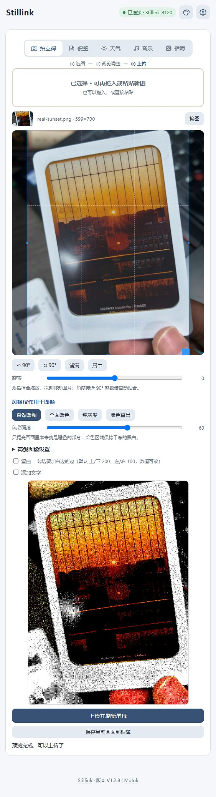
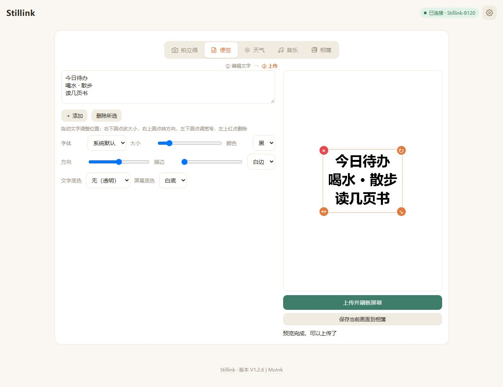
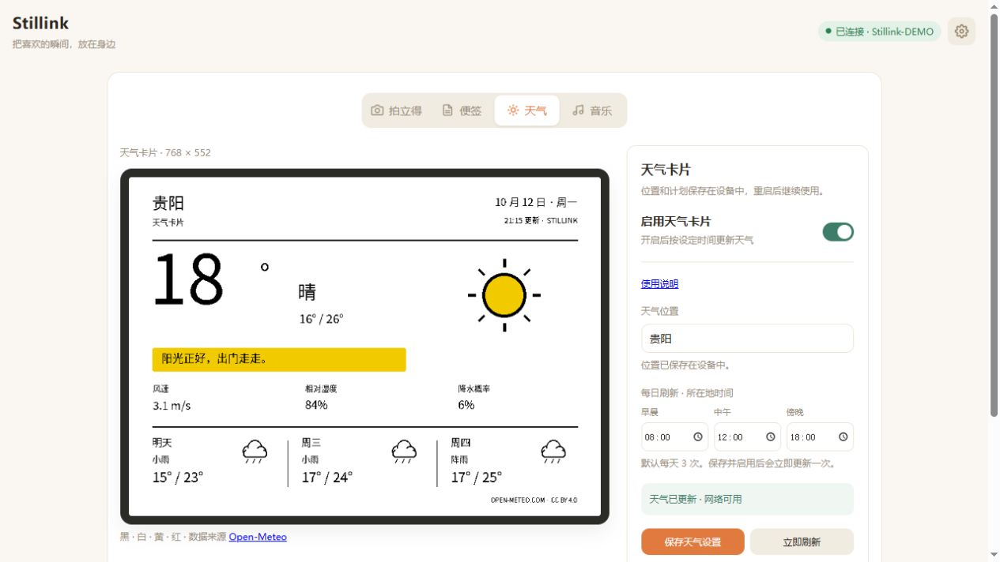
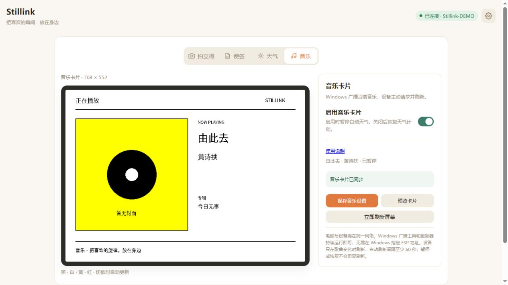
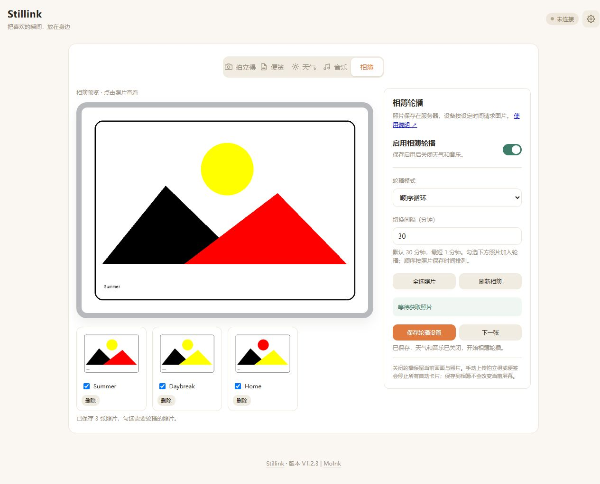
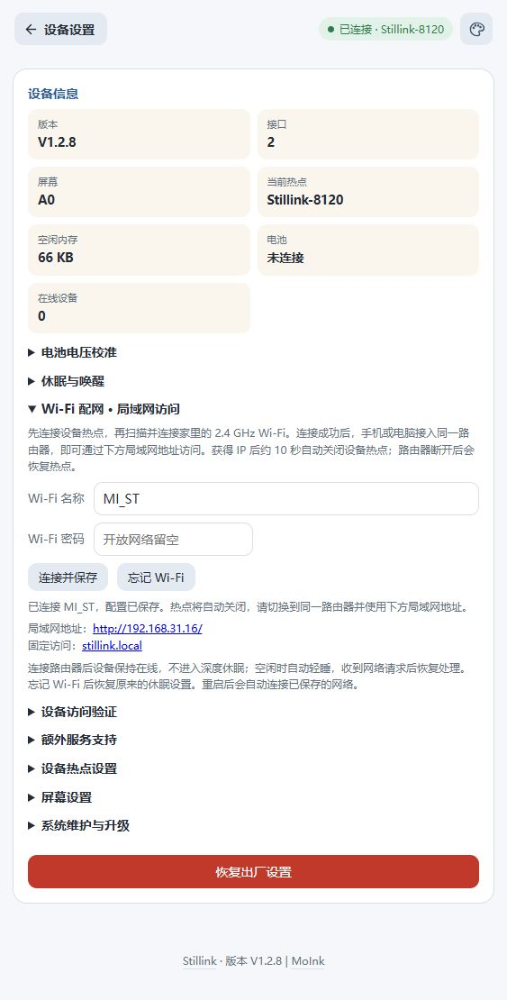
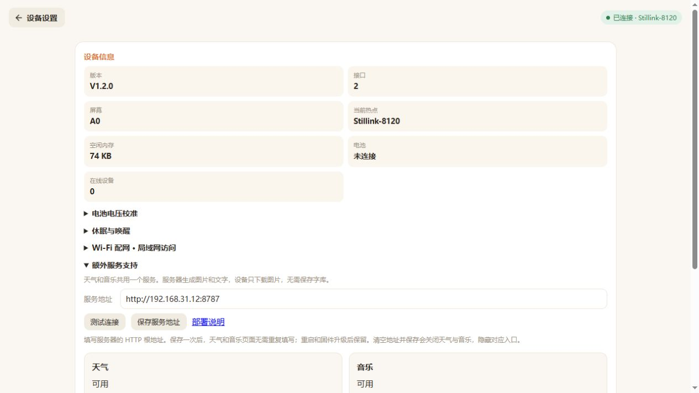
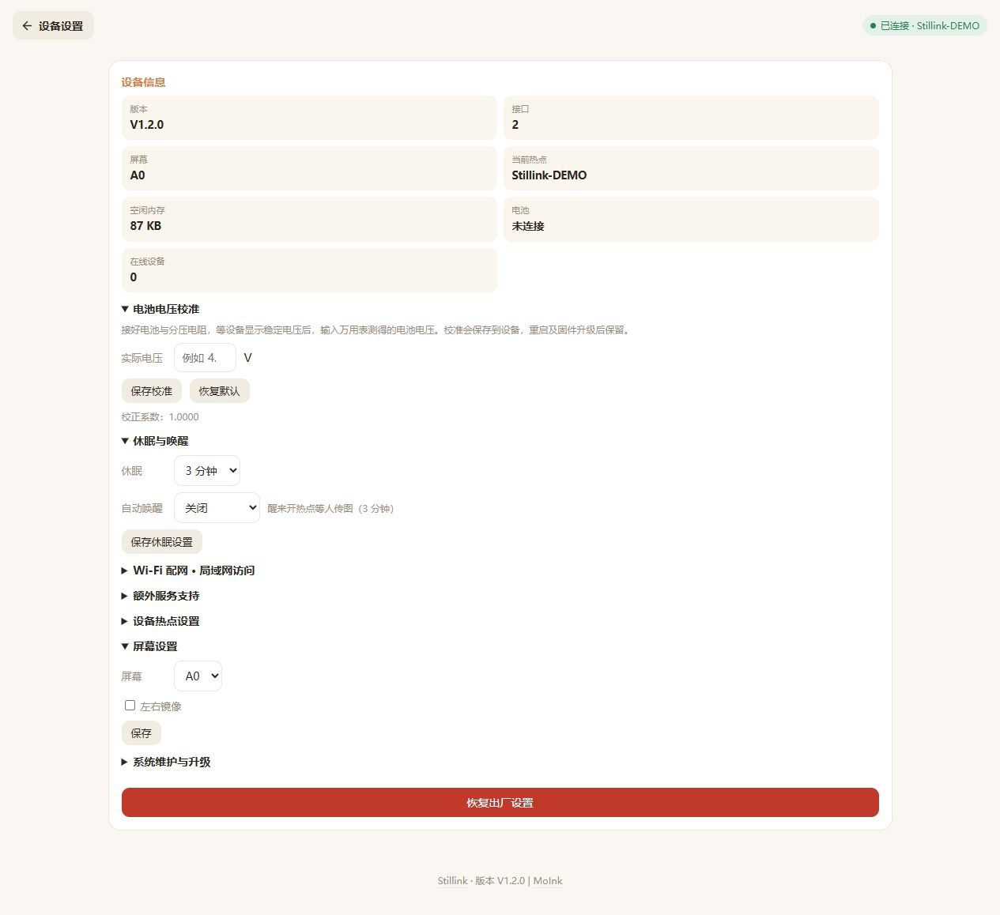
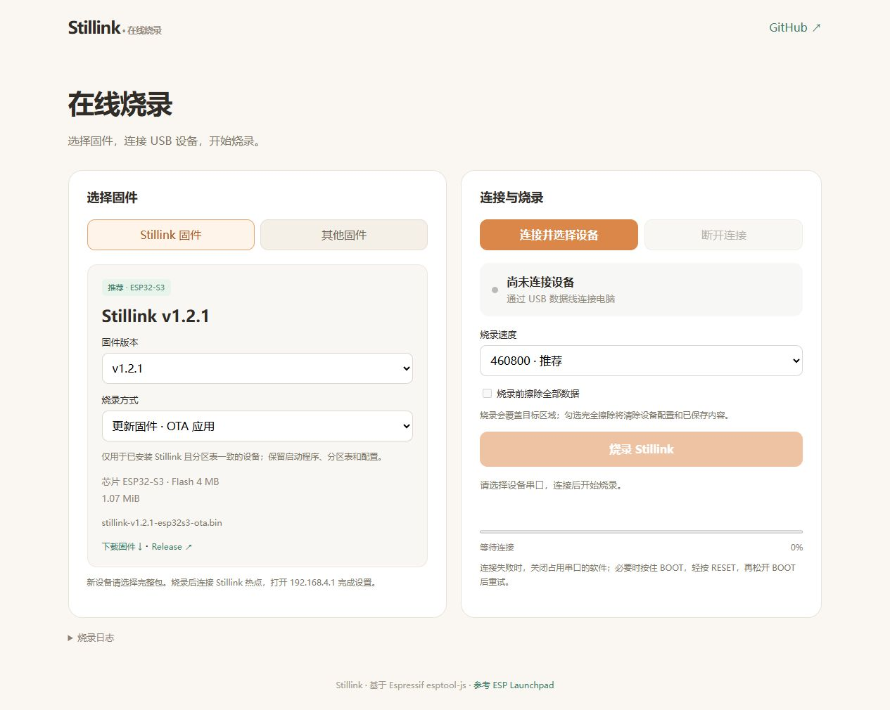
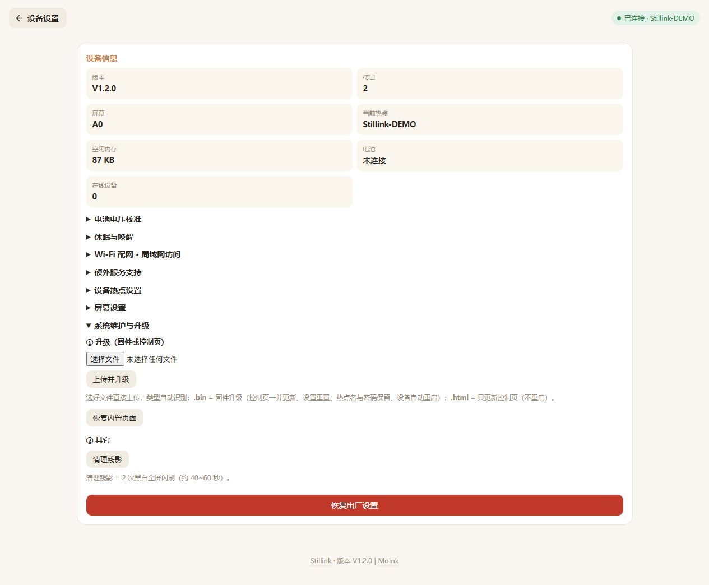

# Stillink

**把喜欢的瞬间，放在身边。**

基于 ESP32-S3 / ESP32-C3 与四色电子墨水屏的网页相框。打开浏览器，就能把照片、便签、天气、正在听的音乐和相簿轮播放到桌面；断电后，画面依然保留。

[快速上手](#快速上手) · [固件构建](#固件构建) · [服务部署](#可选服务部署) · [HTTP API](docs/API.md) · [更新记录](docs/CHANGELOG.md)

## 特色

- **无需 App**：手机、电脑都能操作，支持热点直连与局域网访问。
- **四色墨水屏**：黑、白、黄、红，支持 A0 / A1 屏幕配置。
- **浏览器编辑**：裁剪、旋转、调色、留白和文字排版，本地预览后上传。
- **联网常在线**：连接 Wi-Fi 后空闲轻睡，仍可接收 HTTP 请求；离线支持深睡与按键唤醒。
- **按需扩展**：天气、音乐、相簿共用可选服务，部署并配置后才显示入口。
- **方便维护**：网页上传固件或控制页，支持 HTTP API 和电池电压校准。
- **在线烧录**：[打开烧录页](https://blog.moontung.top/Stillink/)，选择 Release 固件，通过 USB 更新设备或首次安装，也支持本地 BIN。[使用说明](docs/flasher.md)

## 功能展示

以下为新版网页操作截图与卡片渲染预览，墨水屏效果以实物为准。天气、音乐预览统一使用圆角和灰色边框。

### 拍立得

选图、裁剪和旋转，搭配四色风格、留白与文字，把照片变成桌面卡片。



### 便签

写下提醒、待办或喜欢的句子。文字可以拖动、旋转，调整字体、大小、颜色与底色。



### 天气

选择城市或区县，查看当前天气和未来三天预报。默认每天 08:00、12:00、18:00 自动更新，也可自定义时间或手动刷新。[使用说明](docs/weather.md)



### 音乐

Windows 通过 UDP 广播播放器的歌曲、歌手、专辑和封面，服务器生成 **512 × 512 圆角大封面**卡片，右侧显示歌名与歌手，设备在切歌时自动更新。支持接入系统媒体控件的 QQ 音乐、Spotify 等播放器；缺少封面时显示唱片占位图。[使用说明](docs/music.md)



### 相簿

将拍立得处理后的照片或便签画面保存到服务器，点击缩略图预览，勾选照片轮播。支持顺序循环和随机播放，默认每 30 分钟切换，可设置 1 分钟至 24 小时；多台设备共用照片库，各自设置轮播计划。[使用说明](docs/album.md)



### 配网与局域网访问

点击 Wi-Fi 名称自动扫描，连接后保存配置并关闭设备热点。接入同一路由器，即可通过设备 IP 或 [stillink.local](http://stillink.local/) 操作。



### 额外服务支持

天气、音乐与相簿只需配置一次共用服务地址。保存后显示三张状态卡片，展开设置时每 15 秒更新：天气显示服务是否就绪，音乐未收到 Windows 广播时显示「等待音乐」，收到歌曲后才显示「可用」。为节省 ESP 的 Flash 和内存，字库与卡片渲染放在服务器，设备直接下载二进制图片。未配置服务时，只显示拍立得和便签。



### 屏幕与电源设置

切换 A0 / A1 屏幕，设置离线休眠和定时唤醒，并按实测电压校准电池读数。



### 在线烧录

用电脑 Chrome / Edge 打开 [在线烧录页](https://blog.moontung.top/Stillink/)，点击「连接并选择设备」选择 USB 串口。默认使用 Release 的 OTA 应用更新已有设备，新设备选择「首次烧录 · 完整包」。



### 网页升级

设备连接可访问互联网的 Wi-Fi 后，在「系统维护与升级」点击「检查新版本 → 下载并升级」，设备直接下载 Release 中对应芯片的 OTA 包，并显示进度。也可上传 `-ota.bin` 升级固件、上传 `.html` 热更新控制页，或清理残影、恢复内置页面。



## 快速上手

1. 用电脑 Chrome / Edge 打开 [在线烧录页](https://blog.moontung.top/Stillink/)，新设备选择「首次烧录 · 完整包」，点击「连接并选择设备」后烧录。连接设备热点 `Stillink-XXXX`，打开 `http://192.168.4.1`。
2. 在「拍立得」选图，或在「便签」编辑文字，预览后点击「上传并刷新屏幕」。
3. 如需局域网访问，在「设备设置 → Wi-Fi 配网」选择家中的 2.4 GHz 网络并连接，之后可用 `http://stillink.local/` 访问。
4. 如需天气、音乐或相簿，启动下方服务，在「设备设置 → 额外服务支持」保存 HTTP 根地址，再打开对应功能。

`stillink.local` 使用局域网 mDNS，设备响应当前 IP，无需公网域名；设备和客户端需在同一网络，客户端须支持 mDNS。

## 硬件与接线

**ESP32-S3 / ESP32-C3 · 4 MB Flash · 768 × 552 四色墨水屏**。固件不依赖 PSRAM，通过原生 USB Serial/JTAG 下载。

| 屏幕信号 | ESP32-S3 / ESP32-C3 |
| --- | --- |
| SCK | GPIO4 |
| MOSI | GPIO6 |
| CS | GPIO7 |
| DC | GPIO1 |
| RST | GPIO3 |
| BUSY | GPIO10 |
| 唤醒按键 | GPIO5，按下接 GND |
| 电池采样 | GPIO2，470kΩ : 100kΩ 分压 |

唤醒键需单独连接；电池需经合适的稳压及充电电路供电。在设备设置中选择 A0 / A1，并按万用表读数校准电池电压。

## 固件构建

安装并激活 **ESP-IDF 6.1**，通过 SSH 获取工程：

```powershell
git clone git@github.com:sheetung/Stillink.git
cd Stillink
idf.py set-target esp32s3
idf.py build
idf.py -p COM13 flash monitor
```

ESP32-C3 构建时将 `esp32s3` 换为 `esp32c3`。将 `COM13` 换成实际串口。生成 USB 整包与 OTA 应用镜像：

```powershell
python tools/package_bins.py
```

| 文件 | 用途 |
| --- | --- |
| `stillink-vX.Y.Z-esp32s3.bin` | 首次 USB 烧录，写入地址 `0x0` |
| `stillink-vX.Y.Z-esp32s3-ota.bin` | 已有相同分区表的 S3 设备，通过网页 OTA 升级 |
| `page/index.html` | 单独热更新控制页 |

本地打包输出到 `build/dist/`，构建产物不提交到 Git。Release 会分别提供 `esp32s3` 和 `esp32c3` 的完整包与 `-ota.bin`，两种芯片的固件不能混用。在线烧录页可按芯片选择，设备在线升级自动匹配芯片。

固件 OTA 会重置屏幕与休眠等设备设置；Wi-Fi、天气、音乐和电池校准配置保留。升级后确认屏幕设置。

固件可从 [Release](https://github.com/sheetung/Stillink/releases) 下载，或直接使用 [在线烧录页](https://blog.moontung.top/Stillink/)。

## 可选服务部署

Windows 用户可下载 [免安装服务 ZIP](https://github.com/sheetung/Stillink/releases/latest/download/StillinkServices-win.zip)，完整解压后双击 **StillinkServices.exe**。窗口显示可复制的局域网地址，关闭后留在托盘运行；无需安装 Python，天气与相簿可直接使用，音乐另需运行下方的广播工具。照片保存在 `data` 文件夹，更新时请保留。建议在保持开机的设备上运行，详见 [总部署说明](docs/services.md)。

天气、音乐和相簿共用 `extra-services/server` 中的 Python 服务，需要 **Python 3.11+、uv 和中文字体**。Linux 示例：

```bash
sudo apt install git fonts-noto-cjk
git clone git@github.com:sheetung/Stillink.git
cd Stillink/extra-services/server
uv sync --frozen
uv run --frozen app.py --host 0.0.0.0 --port 8787
```

在「设备设置 → 额外服务支持」填写 `http://服务器IP:8787` 并保存。服务默认使用 HTTP `8787` 和音乐 UDP `8790`；常驻运行与 systemd 配置见 [总部署说明](docs/services.md)。天气数据来自 [Open-Meteo](https://open-meteo.com/)，服务需要能访问互联网。

音乐还需在 Windows 下载并解压 [音乐工具包](https://github.com/sheetung/Stillink/releases/latest/download/StillinkMusic-win.zip)，双击 **StillinkMusic.exe**，即可在后台广播当前歌曲，无需安装 Python 或填写地址。右键任务栏通知区域的音乐图标，选择「退出」可停止。Windows 与服务器需处于同一局域网；工具使用与构建见 [音乐说明](docs/music.md)。天气、音乐与相簿轮播互斥：启用并保存其中一项会关闭其他项。拍立得或便签上传成功后，所有自动刷新都会关闭，配置保留。

## 文档

- [HTTP API 与二进制帧格式](docs/API.md)
- [额外服务总部署说明](docs/services.md)
- [天气卡片使用](docs/weather.md)
- [Windows 音乐广播与专辑卡片](docs/music.md)
- [相簿与轮播](docs/album.md)
- [版本更新记录](docs/CHANGELOG.md)
- [在线烧录使用说明](docs/flasher.md)

## 许可

沿用 MoInk 上游的版权与许可限制；上游尚未提供明确的开源协议。Cropper.js 等第三方代码保留各自的许可声明。

## 致谢

感谢 [MoInk](https://github.com/atunverse/moink) 提供原始工程、网页编辑器与墨水屏实现，也感谢 Cropper.js、InkSight 等相关项目的作者。
